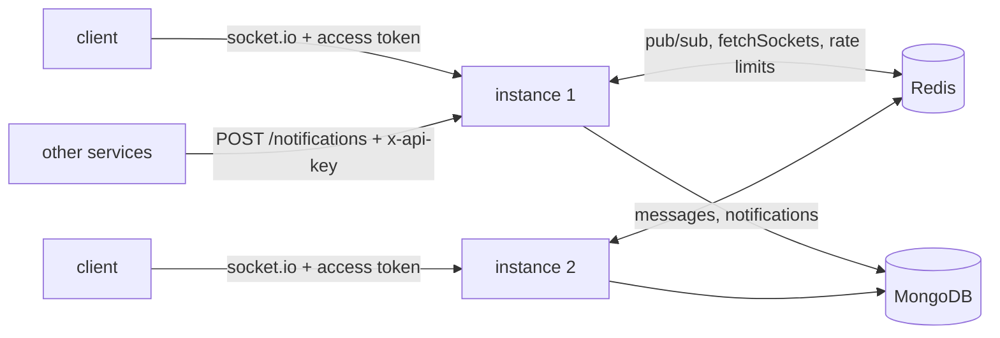

# realtime-chat-gateway

Real-time chat and notifications service on NestJS and Socket.io. Redis pub/sub lets it scale out to several instances, and JWT/RBAC gate the rooms.

A single Socket.io server only knows about the sockets connected to it. Once there are two instances behind a load balancer, a message sent on one has to reach room members on the other, "who is in this room" has to count sockets everywhere, and a notification from another backend service has to find every device a user has open, whichever instance they landed on. This service does that with the Socket.io Redis adapter and keeps the parts that must survive a restart (message history, unread notifications) in MongoDB.

## Architecture



Instances keep no state of their own beyond the sockets connected to them. They share only Redis and MongoDB, so more can be added behind a load balancer. With the default transports a client starts on HTTP long-polling, which needs sticky sessions at the load balancer. Clients that connect with `transports: ['websocket']` don't.

A message on its way from a client on instance 1 to a room member on instance 2:

1. The handshake middleware verifies the access token, stores the user on the socket and joins it to its private `user:<userId>` room.
2. `message:send` checks room membership, the room's access rule and the user's rate limit (a Redis counter).
3. The message is saved to MongoDB, then emitted to `room:<roomId>`.
4. The Socket.io Redis adapter publishes the emit on Redis. Every instance delivers it to its own sockets in that room.

Presence (`room:members`, `users:online`, joined/left events) asks every instance for its sockets through the same adapter, so nothing about who is online is stored. Notifications come in over HTTP on any instance, are saved per user in MongoDB and are emitted to each user's `user:<userId>` room the same way.

Code layout, one Nest module per folder in `src/`:

- `auth`: verifies the handshake token (`SocketAuthService`)
- `chat`: `ChatGateway` (rooms, messages, presence), room access rules and the message rate limit
- `messages`: message schema, repository and history paging
- `notifications`: `POST /notifications`, the per-user inbox and `NotificationGateway`
- `redis`: the shared Redis client and the Socket.io Redis adapter
- `health`: `GET /health`

## Tech stack

Node.js 22, TypeScript, NestJS 11, Socket.io 4 with `@socket.io/redis-adapter`, Redis 7 (ioredis), MongoDB 7 (Mongoose 8), JWT (`@nestjs/jwt`), class-validator, Jest with socket.io-client e2e tests against real Redis and MongoDB, Docker, GitHub Actions.

## Quick start

```
docker compose up -d redis mongo
cp .env.example .env
npm install
npm run start:dev
```

Or run the API in Docker too: `cp .env.example .env && docker compose up --build`. All settings are listed in `.env.example`.

`GET /health` returns `{"status":"ok","mongo":"up","redis":"up"}`, or 503 when either is down.

## Connecting

Clients connect with Socket.io and pass an access token from auth-gateway-service in the handshake:

```js
import { io } from 'socket.io-client';

const socket = io('http://localhost:3000', { auth: { token: accessToken } });
socket.on('connect_error', (err) => console.log(err.message)); // "unauthorized"
```

The token is checked against `JWT_SECRET` (HS256, the same secret auth-gateway-service signs with). A missing, forged or expired token fails the handshake with `unauthorized`, so the socket never connects.

Every instance uses the Socket.io Redis adapter, so a broadcast from one instance reaches sockets connected to any other. Its channels, and the rate limit counters, are prefixed with `SOCKET_IO_REDIS_KEY` (default `socket.io`); give each deployment its own when several share one Redis, otherwise they receive each other's broadcasts.

## Room access

Rooms are created on first join and there is no room registry, so access is decided by the room id's prefix and the `role` claim in the access token:

| Room id | Join | Send |
|---|---|---|
| `admin-*` | admins only | admins only |
| `announce-*` | anyone | admins only |
| anything else | anyone | anyone |

A denied join or send gets `exception` with message `forbidden`. The role is read from the token at the handshake, so a role change applies once the client reconnects with a new access token.

## Events

| Event | Payload | Notes |
|---|---|---|
| `room:join` | `{ roomId }` | acks `{ roomId }`. `roomId` is 1-64 chars of `A-Za-z0-9_-` |
| `room:leave` | `{ roomId }` | acks `{ roomId }` |
| `message:send` | `{ roomId, text }` | text is 1-2000 chars, the socket must have joined the room. Saves the message to MongoDB, acks it and broadcasts `message:new` to the room. Rate limited per user, see below |
| `room:history` | `{ roomId, before?, limit? }` | the socket must have joined the room. Acks messages newest first (`limit` 1-100, default 50); pass the oldest `id` you have as `before` to get the next page |
| `room:members` | `{ roomId }` | the socket must have joined the room. Acks `{ roomId, userIds }`, each user once however many sockets or instances they are on |
| `users:online` | `{ userIds }` | 1-100 user ids. Acks `{ online }`, the ones with at least one socket on any instance, in the order asked. Works for users you share no room with, e.g. a contact or DM list |
| `presence:joined` / `presence:left` | `{ roomId, userId }` | server to room. Only sent when a user's first socket joins or their last socket leaves (leave, disconnect), and not to the sender |
| `notification:unread` | `{ before?, limit? }` | acks the user's unread notifications newest first (`limit` 1-100, default 50); pass the oldest `id` you have as `before` to get the next page |
| `notification:read` | `{ ids }` | 1-100 notification ids. Marks them read for this user only and acks `{ updated }`, the number that were still unread |
| `notification:marked-read` | `{ ids }` | server to the user's other sockets, on any instance, after a `notification:read` that changed something. `ids` are only the ones that were still unread |

Presence is read from the live sockets through the Redis adapter (`fetchSockets`), so nothing is stored. The adapter waits up to 5s for every instance to answer, which is why `room:join` acks first and announces in the background.

A bad payload or sending into a room you haven't joined makes the server emit `exception` with `{ status: 'error', message }`.

Each user can send `MESSAGE_RATE_LIMIT` messages (default 20) per `MESSAGE_RATE_WINDOW_SECONDS` (default 10), counted in Redis across all their sockets and instances. Past that, `message:send` gets `exception` with message `rate limited` and nothing is saved. It's a fixed window that starts at the user's first message, so a burst at the edge of two windows can get up to twice the limit through. If Redis is down the limit is skipped rather than blocking chat; the outage is already logged by the Redis connection.

## Notifications

Other backend services push notifications to users over HTTP, and every socket the user has open gets them, whichever instance it's connected to:

```
curl -X POST http://localhost:3000/notifications \
  -H 'x-api-key: <NOTIFY_API_KEY>' -H 'content-type: application/json' \
  -d '{"userIds":["<user id>"],"type":"order.paid","data":{"orderId":"..."}}'
```

| Method | Path | Notes |
|---|---|---|
| `POST` | `/notifications` | needs `x-api-key` = `NOTIFY_API_KEY` (401 otherwise). `userIds` 1-1000 unique ids, `type` 1-64 chars of `a-z0-9._:-`, `data` an optional object. Returns 202 `{ id }`, or 503 when it can't be saved |

Sockets get a `notification` event with `{ id, type, data, sentAt }`. Each socket joins a private `user:<userId>` room during the handshake, before `connect` fires, so a notification sent right after connecting isn't missed. Clients can't join those rooms themselves, because `room:join` only accepts plain room ids. A socket listed under several users still gets one copy.

Every notification is saved to Mongo first, one copy per user (`notifications` collection), and only then emitted. If the save fails, the endpoint returns 503 and nothing is sent, so the caller can retry. Copies expire after 30 days through a TTL index on `sentAt`.

A client that was offline catches up after connecting with `notification:unread` and marks what it has shown with `notification:read`. Read state is per user, so marking a notification read on one device also removes it from the unread list on the others, and their open sockets get `notification:marked-read` right away so they can clear their badges without refetching.

## Tests

```
npm test
npm run test:e2e
```

The e2e tests need Redis on `REDIS_HOST:REDIS_PORT` and MongoDB on `MONGO_URI`. Each suite gets its own `SOCKET_IO_REDIS_KEY` (`test/setup-env.ts`), so suites running in parallel on one Redis don't see each other's instances. Without that, `fetchSockets` in one suite waited on the apps of every other suite and stalled when one of them was shutting down.

## License

MIT
